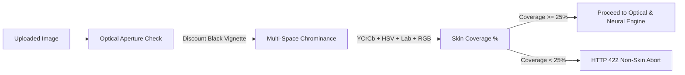

# 🔬 SkinLens — Explainable AI-Powered Skin Lesion Screening Platform

[](https://fastapi.tiangolo.com/)
[](https://pytorch.org/)
[](https://huggingface.co/adeIaide/skin-lesion-7class-efficientnet)
[](https://react.dev/)
[](https://tailwindcss.com/)
[](https://vitejs.dev/)
[](https://isic-archive.com/)

**SkinLens** is an explainable, clinical decision-support platform designed to assist dermatologists, general practitioners, and triage clinicians in screening suspicious skin lesions. 

Unlike traditional "black-box" classifiers, SkinLens couples a fine-tuned **EfficientNet-B0** convolutional neural network with an automated **Pre-Classification Bio-Optical Skin Gate**, genuine **Grad-CAM (Gradient-Weighted Class Activation Mapping)** visual interpretability, and a structured **Clinician Review & Specialist Referral** workflow.

---

## 📑 Table of Contents

- [Key Highlights](#-key-highlights)
- [The 5-Step Clinical Screening Workflow](#-the-5-step-clinical-screening-workflow)
- [System Architecture & Technology Stack](#-system-architecture--technology-stack)
- [Deep Learning & Explainability Pipeline](#-deep-learning--explainability-pipeline)
- [Pre-Classification Skin & Domain Validation](#-pre-classification-skin--domain-validation)
- [Project Directory Structure](#-project-directory-structure)
- [Quick Start Guide](#-quick-start-guide)
- [REST API Reference](#-rest-api-reference)
- [Responsible AI & Clinical Governance](#-responsible-ai--clinical-governance)

---

## 🌟 Key Highlights

- **🛡️ Pre-Classification Bio-Optical Skin Gate**: Multi-space chrominance ($\text{YCrCb} + \text{HSV} + \text{Lab} + \text{RGB}$) validation intercepts non-skin uploads (cars, pets, documents, foliage) *before* classification to prevent artificial false-positive cancer predictions.
- **🔍 Real Grad-CAM Interpretability**: Hooks into Layer 4 feature maps of EfficientNet-B0 to backpropagate gradients and synthesize true spatial saliency heatmaps, allowing clinicians to visually audit whether the model focused on real pigment networks versus skin hair or artifacts.
- **⚡ Sub-250ms CPU Inference**: Compound scaling enables rapid execution on standard local clinical workstations without requiring dedicated GPU infrastructure.
- **📊 Calibrated 7-Class HAM10000 Coverage**: Detects and ranks Melanoma (MEL), Melanocytic Nevus (NV), Basal Cell Carcinoma (BCC), Actinic Keratosis (AKIEC), Benign Keratosis (BKL), Dermatofibroma (DF), and Vascular Lesions (VASC).
- **🩺 Actionable Decision Support**: Automatically computes **Prototype Screening Priority** (*Routine Follow-up*, *Review Recommended*, *Prompt Professional Evaluation*) and generates specialist referral dockets (`REF-2026-XXXX`).

---

## 🔄 The 5-Step Clinical Screening Workflow

```
┌─────────────┐     ┌──────────────┐     ┌─────────────┐     ┌─────────────┐     ┌─────────────────┐
│ 01 CAPTURE  │ ──> │  02 VALIDATE │ ──> │ 03 ANALYZE  │ ──> │  04 EXPLAIN │ ──> │ 05 CLINICAL ACT │
└─────────────┘     └──────────────┘     └─────────────┘     └─────────────┘     └─────────────────┘
  Patient Intake      Skin Domain Gate     EfficientNet-B0     Real Grad-CAM       Screening Priority
  Lesion Context      Optical Quality      Softmax Prob        Saliency Layer      Attestation / Ref
```

1. **`01 Capture` — Patient Intake & Clinical Context**
   - Clinician records patient demographics (Name, Age), anatomical location (e.g., *Upper Back*, *Face/Neck*), lesion duration, and observable symptoms (bleeding, rapid enlargement, color darkening).
   - High-resolution clinical or dermoscopic photograph uploaded via drag-and-drop.

2. **`02 Validate` — Optical Quality & Cutaneous Pre-Gate**
   - **Skin Presence Gate**: Excludes dermoscopy barrel vignetting and validates biological melanin/hemoglobin spectrum ($Cr - Cb \ge 10$, warm cutaneous HSV hue).
   - **Optical Heuristics**: Assesses Laplacian blur variance ($\sigma^2 \ge 2.0$), mean luminance exposure ($35 \le \mu \le 230$), contrast standard deviation, and spatial resolution ($\ge 200 \times 200\text{px}$).

3. **`03 Analyze` — Deep Neural Classification**
   - Tensor normalization with ImageNet mean/std ($320 \times 320\text{px}$).
   - Forward pass through fine-tuned EfficientNet-B0 backbone.
   - Outputs primary condition classification, softmax confidence score, and top-3 differential diagnosis distribution.

4. **`04 Explain` — Grad-CAM Feature Saliency**
   - Computes gradient backpropagation of the predicted class score with respect to the final convolutional feature block.
   - Generates Jet-colormap activation heatmap and blends an alpha-composite overlay over the original lesion photo.
   - Interactive viewer supports side-by-side comparison and split-screen opacity adjustment.

5. **`05 Clinical Action` — Decision Support & Specialist Triage**
   - Assigns Prototype Screening Priority based on calibrated risk level.
   - Displays ABCDE clinical assessment criteria.
   - Clinician selects one of three actionable paths:
     - **[ Mark as Reviewed ]**: Approves findings and logs notes into the permanent case registry.
     - **[ Request Better Image ]**: Flags poor capture fidelity or hair interference for patient retake.
     - **[ Refer for Specialist Review ]**: Automatically generates a formal specialist referral with triage code and printable clinical summary.

---

## 🏗️ System Architecture & Technology Stack

| Layer | Technologies | Rationale |
| :--- | :--- | :--- |
| **Deep Learning Engine** | **PyTorch 2.x**, `safetensors`, `torchvision` | Provides gradient hooks for genuine Grad-CAM backpropagation. `safetensors` delivers instant zero-copy model weight loading without arbitrary code execution risk. |
| **Neural Backbone** | **EfficientNet-B0** (3.7M parameters) | Pre-trained on ImageNet and fine-tuned on **HAM10000 / ISIC 2018**. Offers state-of-the-art accuracy with sub-200ms CPU inference time. |
| **Explainable AI (XAI)** | **Grad-CAM Engine** (`cv2`, `numpy`, `torch`) | Eliminates medical "black-box" opacity by visualizing the precise morphological features driving the model's prediction. |
| **Pre-Gate Computer Vision**| **OpenCV 4.x**, **Pillow** | Performs deterministic, sub-5ms biological skin validation and optical blur/lighting checks *before* classification. |
| **Backend REST API** | **FastAPI**, **Uvicorn**, **Pydantic v2** | High-performance asynchronous ASGI framework with automated OpenAPI interactive documentation and strict type validation. |
| **Frontend Application** | **React 18**, **TypeScript**, **Vite** | Strict type safety across clinical diagnostic interfaces, sub-second HMR development, and responsive layouts. |
| **Styling & Components** | **Tailwind CSS**, **Lucide Icons** | High-contrast clinical design system, dark-mode Grad-CAM visualizer, and animated workflow transitions. |

---

## 🧠 Deep Learning & Explainability Pipeline

### 1. Model Architecture
- **Base Architecture**: EfficientNet-B0 with custom linear classification head (`3.7M fine-tuned parameters`).
- **Input Resolution**: $320 \times 320\text{px}$ RGB.
- **Normalization**: ImageNet statistics ($\text{mean}=[0.485, 0.456, 0.406], \text{std}=[0.229, 0.224, 0.225]$).
- **Target Benchmark**: ISIC 2018 / HAM10000 7-Class Challenge:
  - `MEL`: Melanoma (Malignant)
  - `NV`: Melanocytic Nevus (Benign)
  - `BCC`: Basal Cell Carcinoma (Malignant)
  - `AKIEC`: Actinic Keratosis / Intraepithelial Carcinoma (Pre-malignant)
  - `BKL`: Benign Keratosis-like Lesion (Benign)
  - `DF`: Dermatofibroma (Benign)
  - `VASC`: Vascular Lesion (Benign)

### 2. Real Grad-CAM Formulation
Grad-CAM calculates the gradient of the predicted class score $y^c$ with respect to the activation maps $A^k$ of the final convolutional layer (`model.encoder[0][-1]`):

$$\alpha_k^c = \frac{1}{Z} \sum_{i=1}^U \sum_{j=1}^V \frac{\partial y^c}{\partial A_{i,j}^k}$$

The weighted combination of forward feature activation maps is passed through a Rectified Linear Unit (ReLU) to isolate features positively correlated with the class:

$$L_{\text{Grad-CAM}}^c = \text{ReLU}\left(\sum_k \alpha_k^c A^k\right)$$

The resulting activation map is normalized ($[0, 1]$), upscaled via bilinear interpolation to original dimensions, colorized using OpenCV's `COLORMAP_JET`, and blended with opacity $\alpha = 0.45$.

---

## 🛡️ Pre-Classification Skin & Domain Validation

Standard neural classifiers have a closed-world assumption: feeding an image of a dog, car, or text document into a 7-class lesion model forces the softmax layer to output a cancer diagnosis with high confidence.

SkinLens solves this with a **Pre-Classification Bio-Optical Gate**:



1. **Aperture & Vignette Segmentation**: Excludes dermatoscope contact plate borders ($R, G, B < 25$).
2. **Cutaneous Melanin/Hemoglobin Rules**:
   - In **$\text{YCrCb}$**: $Cr \in [130, 185], Cb \in [75, 138], Cr - Cb \ge 10$.
   - In **$\text{HSV}$**: $H \le 28^\circ \cup H \ge 165^\circ, S \in [18, 225], V \ge 35$.
   - In **$\text{Lab}$**: Bounded yellow chroma ($b^* \le 24$) to differentiate skin from high-lignin wood and plastics.
   - In **$\text{RGB}$**: $R > G > B$ biological vascular absorption.
3. **Out-of-Distribution Rejection**:
   - If skin coverage $< 25\%$ or dominant environmental green/blue exceeds $35\%$, the backend safely halts inference with:
     ```json
     {
       "detail": "Non-skin image detected (0.0% skin coverage). SkinLens requires an image of human skin or a dermatological lesion. Classification halted to prevent invalid clinical prediction."
     }
     ```

---

## 📁 Project Directory Structure

```
skin-lesion-project/
├── README.md                            # Comprehensive Platform Documentation
├── .gitignore                           # Git ignore rules for Python & Node
└── skinlens/
    ├── frontend/                        # React 18 + TypeScript + Vite + Tailwind CSS
    │   ├── public/
    │   │   └── samples/                 # Demo presets (Melanoma, BCC, Nevus)
    │   ├── src/
    │   │   ├── components/              # UI Components
    │   │   │   ├── ABCDECard.tsx        # Clinical ABCDE criteria card
    │   │   │   ├── Badge.tsx            # Status & risk badges
    │   │   │   ├── Button.tsx           # Standardized clinical buttons
    │   │   │   ├── Card.tsx             # Card containers
    │   │   │   ├── CaseSummaryModal.tsx # Printable clinical referral modal
    │   │   │   ├── ClinicianReviewPanel.tsx # Action attestation & notes
    │   │   │   ├── GradCAMViewer.tsx    # Interactive split-slider XAI visualizer
    │   │   │   ├── Navbar.tsx           # Clean application header & connection status
    │   │   │   ├── PrototypeScreeningPriority.tsx # Calibrated decision-support priority
    │   │   │   ├── QualityIndicator.tsx # 4-bar optical & skin tissue fidelity card
    │   │   │   └── WorkflowIndicator.tsx# 5-step progress header
    │   │   ├── pages/                   # Application Views
    │   │   │   ├── LandingPage.tsx      # Public presentation & platform overview
    │   │   │   ├── DashboardPage.tsx    # Clinical metrics, recent cases, action hub
    │   │   │   ├── NewScreeningPage.tsx # Intake form, image upload, AI pipeline animation
    │   │   │   ├── ScreeningResultPage.tsx # AI diagnosis, Grad-CAM hero, differential bars
    │   │   │   ├── CasesPage.tsx        # Searchable registry with status filters
    │   │   │   └── CaseDetailsPage.tsx  # In-depth case file & referral status
    │   │   ├── services/
    │   │   │   └── api.ts               # Typed fetch client connecting to FastAPI backend
    │   │   ├── types/
    │   │   │   └── index.ts             # TypeScript interfaces for cases, AI outputs, reviews
    │   │   ├── App.tsx                  # Root state management & page routing
    │   │   ├── main.tsx                 # React DOM mount point
    │   │   └── index.css                # Tailwind directives & keyframe animations
    │   ├── package.json
    │   ├── vite.config.ts
    │   └── tailwind.config.js
    │
    └── backend/                         # FastAPI + PyTorch + OpenCV Backend
        ├── app/
        │   ├── main.py                  # API routes, CORS, error handling
        │   ├── models/
        │   │   └── schemas.py           # Pydantic v2 schemas for requests & responses
        │   ├── services/
        │   │   ├── skin_validator.py    # Bio-optical multi-space skin presence gate
        │   │   ├── image_quality.py     # Optical heuristics (blur, lighting, contrast)
        │   │   ├── model_service.py     # Real EfficientNet-B0 PyTorch inference
        │   │   ├── gradcam_service.py   # Layer-4 gradient backpropagation engine
        │   │   ├── classification_service.py # Risk calibration & differential ranking
        │   │   └── case_service.py      # Case registry persistence
        │   └── utils/
        │       └── image_processing.py  # OpenCV & Pillow conversion helpers
        ├── test_model.py                # Standalone CLI testing script
        └── requirements.txt             # Backend Python dependencies
```

---

## 🚀 Quick Start Guide

### Prerequisites
- **Python**: 3.10, 3.11, or 3.12
- **Node.js**: v18.0.0 or higher
- **npm**: v9.0.0 or higher

---

### 1. Backend Setup (FastAPI & PyTorch)

```bash
# 1. Navigate to backend directory
cd skinlens/backend

# 2. Create and activate a Python virtual environment
python3 -m venv venv
source venv/bin/activate

# 3. Install backend dependencies
pip install -r requirements.txt

# 4. Start the FastAPI development server on port 8005
uvicorn app.main:app --host 127.0.0.1 --port 8005 --reload
```

- **Interactive Swagger API Docs**: [`http://127.0.0.1:8005/docs`](http://127.0.0.1:8005/docs)
- **Alternative ReDoc**: [`http://127.0.0.1:8005/redoc`](http://127.0.0.1:8005/redoc)
- **Health Check Endpoint**: [`http://127.0.0.1:8005/api/health`](http://127.0.0.1:8005/api/health)

#### Standalone CLI Verification
You can test the real PyTorch model, skin validator, and Grad-CAM directly from your terminal:
```bash
# Test on a skin lesion image
python test_model.py ../frontend/public/samples/melanoma_sample.jpg --gradcam --quality

# Test on a non-skin image (triggers safe rejection)
python test_model.py path/to/non_skin_photo.jpg --quality
```

---

### 2. Frontend Setup (React + Vite)

In a separate terminal window:

```bash
# 1. Navigate to frontend directory
cd skinlens/frontend

# 2. Install dependencies
npm install

# 3. Start the Vite dev server
npm run dev
```

- **Web Application URL**: [`http://127.0.0.1:5173/`](http://127.0.0.1:5173/)
- **Production Build Validation**: `npm run build`

---

## 📡 REST API Reference

| Method | Endpoint | Description | Payload / Parameters |
| :--- | :--- | :--- | :--- |
| `POST` | `/api/screen` | **Core Screening Pipeline**: Validates skin domain, verifies optical quality, runs EfficientNet-B0 inference, computes Grad-CAM, creates case. | `multipart/form-data`: `image` (file), `patient_name`, `age`, `lesion_location`, `duration`, `clinical_notes` |
| `POST` | `/api/quality-check` | Optical quality & skin presence assessment without running classification. | `multipart/form-data`: `image` |
| `POST` | `/api/predict` | Raw EfficientNet-B0 inference returning top prediction, confidence, and differentials. | `multipart/form-data`: `image` |
| `POST` | `/api/gradcam` | Generates standalone Grad-CAM heatmap and blended overlay. | `multipart/form-data`: `image`, `alpha` query parameter |
| `GET` | `/api/cases` | Retrieves list of all screening cases with optional status/risk filtering. | Query: `status`, `risk`, `search` |
| `GET` | `/api/cases/{case_id}` | Retrieves complete case profile including Grad-CAM URLs and review history. | Path: `case_id` |
| `POST` | `/api/cases/{case_id}/review` | Submits clinician review attestation, status update, and specialist referral. | JSON body with review details |
| `POST` | `/api/cases/reset-demo` | Resets the case registry to default demo cases. | None |
| `GET` | `/api/stats` | Dashboard metrics (Screenings today, awaiting review, high-risk counts). | None |
| `GET` | `/api/health` | Service health status and model availability check. | None |

---

## ⚖️ Responsible AI & Clinical Governance

> [!IMPORTANT]
> **Research & Ideathon Prototype Disclaimer**:
> SkinLens is an **AI-assisted clinical decision-support prototype**. It is intended to augment, not replace, professional clinical evaluation.
>
> - SkinLens does **not** provide definitive clinical diagnoses.
> - The software produces probabilistic screening signals and calibrated screening priorities (*Routine Follow-up*, *Review Recommended*, *Prompt Professional Evaluation*) to assist licensed healthcare providers in triage.
> - Diagnostic decisions and surgical biopsy determinations must always be made by a qualified dermatologist or medical practitioner.

---

## 👥 Contributors & Acknowledgements

- **AI Model**: [`adeIaide/skin-lesion-7class-efficientnet`](https://huggingface.co/adeIaide/skin-lesion-7class-efficientnet) fine-tuned on the **HAM10000** (Human Against Machine with 10,000 training images) dataset.
- **ISIC Archive**: International Skin Imaging Collaboration for dermoscopy benchmarks.
- **Explainability**: Based on the Grad-CAM methodology (*Selvaraju et al., 2017*).
